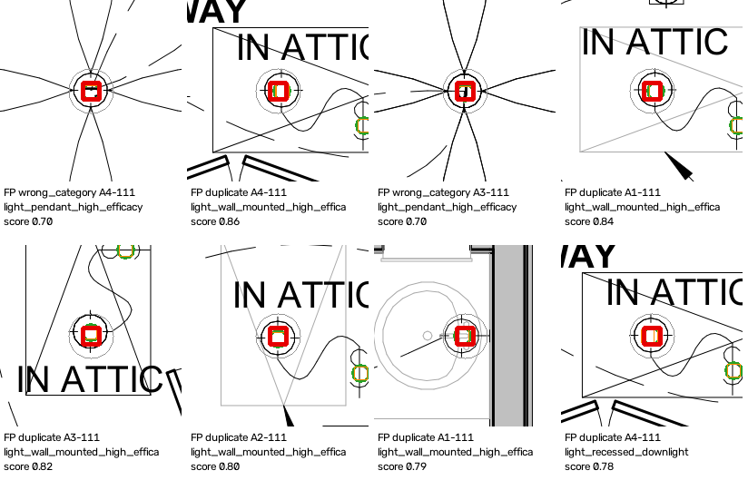
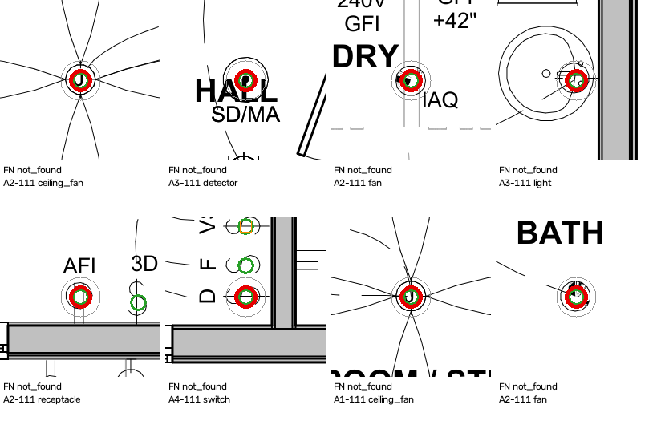
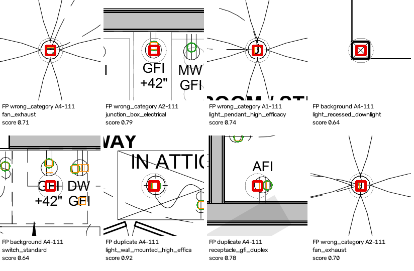
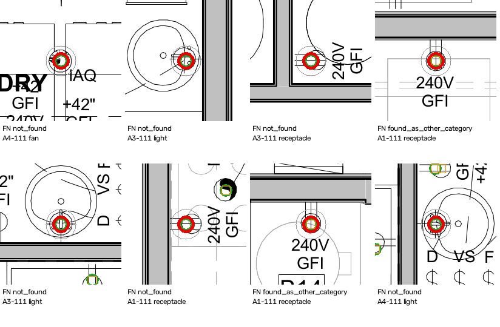
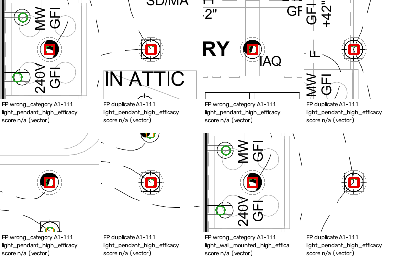
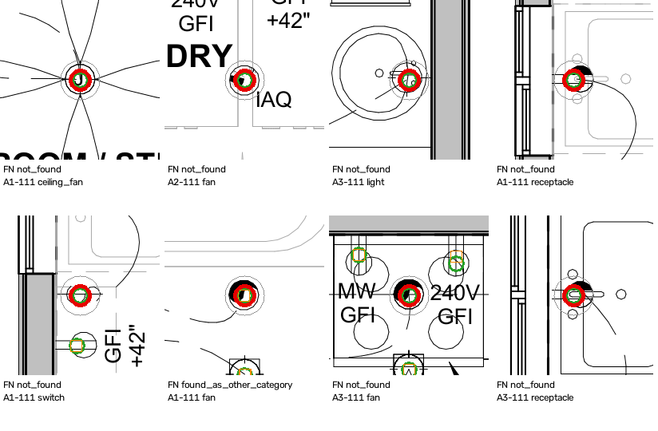

# Candidate-generator evaluation — gt_001_20261025T020009Z (eval/1)

**These are review-hint generators, not detectors.** The numbers measure how well each Milestone 1 candidate generator's template hits match the hand-verified devices. They are a baseline for choosing a detector approach (T-01), not a release-quality result.

## Read this first: what the numbers can and cannot show

- **The ground truth was built with these candidates as hints.** Of 300 devices, 298 started as a candidate and 2 were added by hand. A device that every generator and the reviewer missed cannot appear here, so **recall is an upper bound**.
- **Accepted positions were copied.** Where the reviewer accepted a candidate without moving it, the ground-truth point is that candidate's point (distance ≤ 0.05 pt). Localization is reported only over the *independent* pairs; the copied ones say nothing about accuracy.
- **Single reviewer**; no inter-annotator agreement (see the export manifest's known limitations).
- **Not evaluated:**
  - *subtype*: Each template implies one fixed subtype; real subtypes come from adjacent text tokens, which the generators do not read.
  - *room*: Generators assign no room; room extraction (B-06) is not built yet.
  - *status*: Status follows from category (ceiling fans are optional_pre_wire); not predicted separately.
- **Background false positives are where to spot-check the ground truth.** A hit on nothing is either a generator error or a device the review missed; the examples below show some.

## Method

- Export `gt_001_20261025T020009Z` (level `verified`, protocol/1, taxonomy/1, gt-schema/1); manifest SHA-256 `f03b11a38264a348…`.
- Candidates regenerated and checked against the manifest's run hashes: `raster_plain` `5769aa2eb5ca`, `raster_thickened` `c655baca6616`, `vector_signature` `b7f67ef48937`.
- Only candidates inside each sheet's confirmed electrical region count. A candidate's category is the one its template implies.
- One-to-one matching per sheet and category: pairs within **6 pt** (the protocol's match tolerance; boundary inclusive), nearest first. Sensitivity at 3 and 12 pt below.
- False positives are split into *duplicate* (another hit on a device already matched), *wrong category* (on a device of another category) and *background*. Misses are *found as another category* or *not found*.
- Code: `9c6f207f4656513eb3e618ec716a6749fa24f25e`.

## Summary

| Generator | In scope | TP | FP | FN | Precision | Recall | F1 | Localization median / p90, pt (independent) |
|---|---|---|---|---|---|---|---|---|
| `raster_plain` | 218 | 178 | 40 | 122 | 0.82 | 0.59 | 0.69 | 0.24 / 0.24 (n=16) |
| `raster_thickened` | 539 | 276 | 263 | 24 | 0.51 | 0.92 | 0.66 | 2.28 / 2.29 (n=27) |
| `vector_signature` | 401 | 280 | 121 | 20 | 0.70 | 0.93 | 0.80 | 0.19 / 2.10 (n=263) |

Excluded before matching: `raster_plain` 0 outside the region, 0 with no category; `raster_thickened` 0 outside the region, 0 with no category; `vector_signature` 0 outside the region, 0 with no category.

## Found by at least one generator

| Category | Devices | Found | Recall (upper bound) |
|---|---|---|---|
| ceiling_fan | 8 | 8 | 1.00 |
| detector | 14 | 14 | 1.00 |
| fan | 14 | 13 | 0.93 |
| light | 63 | 62 | 0.98 |
| receptacle | 133 | 133 | 1.00 |
| switch | 68 | 68 | 1.00 |
| **all** | 300 | 298 | 0.99 |

## `raster_plain` by category

| Category | GT | Candidates | TP | FP | FN | Precision | Recall | FP kinds | Miss kinds | Localization (independent) |
|---|---|---|---|---|---|---|---|---|---|---|
| ceiling_fan | 8 | 5 | 5 | 0 | 3 | 1.00 | 0.62 | — | not_found 3 | 0.24 / 0.24 (n=1) |
| detector | 14 | 13 | 13 | 0 | 1 | 1.00 | 0.93 | — | not_found 1 | 0.24 / 0.24 (n=1) |
| fan | 14 | 7 | 7 | 0 | 7 | 1.00 | 0.50 | — | not_found 7 | — |
| light | 63 | 97 | 57 | 40 | 6 | 0.59 | 0.90 | duplicate 38, wrong_category 2 | not_found 6 | 0.17 / 0.17 (n=2) |
| receptacle | 133 | 61 | 61 | 0 | 72 | 1.00 | 0.46 | — | not_found 72 | 0.24 / 0.24 (n=10) |
| switch | 68 | 35 | 35 | 0 | 33 | 1.00 | 0.51 | — | not_found 33 | 0.24 / 0.24 (n=2) |

Duplicate hits, by template pair (duplicate → the hit that matched the device): `light_pendant_high_efficacy` → `light_recessed_downlight` 28; `light_wall_mounted_high_efficacy` → `light_pendant_high_efficacy` 6; `light_recessed_downlight` → `light_pendant_high_efficacy` 4.

## `raster_thickened` by category

| Category | GT | Candidates | TP | FP | FN | Precision | Recall | FP kinds | Miss kinds | Localization (independent) |
|---|---|---|---|---|---|---|---|---|---|---|
| ceiling_fan | 8 | 8 | 8 | 0 | 0 | 1.00 | 1.00 | — | — | 0.12 / 0.12 (n=1) |
| detector | 14 | 14 | 14 | 0 | 0 | 1.00 | 1.00 | — | — | — |
| fan | 14 | 21 | 13 | 8 | 1 | 0.62 | 0.93 | wrong_category 8 | not_found 1 | — |
| junction_box | 0 | 106 | 0 | 106 | 0 | 0.00 | — | wrong_category 106 | — | — |
| light | 63 | 189 | 59 | 130 | 4 | 0.31 | 0.94 | background 3, duplicate 103, wrong_category 24 | not_found 4 | 0.12 / 0.27 (n=6) |
| receptacle | 133 | 125 | 114 | 11 | 19 | 0.91 | 0.86 | duplicate 11 | found_as_other_category 5, not_found 14 | 2.28 / 2.29 (n=20) |
| switch | 68 | 76 | 68 | 8 | 0 | 0.89 | 1.00 | background 8 | — | — |

Duplicate hits, by template pair (duplicate → the hit that matched the device): `light_pendant_high_efficacy` → `light_recessed_downlight` 41; `light_wall_mounted_high_efficacy` → `light_recessed_downlight` 38; `light_wall_mounted_high_efficacy` → `light_pendant_high_efficacy` 13; `light_recessed_downlight` → `light_pendant_high_efficacy` 11; `receptacle_gfi_duplex` → `receptacle_gfi_duplex` 11.

## `vector_signature` by category

| Category | GT | Candidates | TP | FP | FN | Precision | Recall | FP kinds | Miss kinds | Localization (independent) |
|---|---|---|---|---|---|---|---|---|---|---|
| ceiling_fan | 8 | 7 | 7 | 0 | 1 | 1.00 | 0.88 | — | not_found 1 | 0.19 / 0.31 (n=7) |
| detector | 14 | 14 | 14 | 0 | 0 | 1.00 | 1.00 | — | — | 0.13 / 0.22 (n=14) |
| fan | 14 | 0 | 0 | 0 | 14 | — | 0.00 | — | found_as_other_category 8, not_found 6 | — |
| light | 63 | 183 | 62 | 121 | 1 | 0.34 | 0.98 | duplicate 105, wrong_category 16 | not_found 1 | 0.18 / 0.19 (n=59) |
| receptacle | 133 | 130 | 130 | 0 | 3 | 1.00 | 0.98 | — | not_found 3 | 0.19 / 2.47 (n=116) |
| switch | 68 | 67 | 67 | 0 | 1 | 1.00 | 0.99 | — | not_found 1 | 0.97 / 1.20 (n=67) |

Duplicate hits, by template pair (duplicate → the hit that matched the device): `light_pendant_high_efficacy` → `light_recessed_downlight` 46; `light_wall_mounted_high_efficacy` → `light_recessed_downlight` 46; `light_wall_mounted_high_efficacy` → `light_pendant_high_efficacy` 13.

## Per-sheet counts

Ground-truth count, then each generator's in-scope candidate count / true positives.

| Sheet | Category | GT | `raster_plain` | `raster_thickened` | `vector_signature` |
|---|---|---|---|---|---|
| A1-111 | ceiling_fan | 1 | 0 / 0 | 1 / 1 | 0 / 0 |
| A1-111 | detector | 2 | 2 / 2 | 2 / 2 | 2 / 2 |
| A1-111 | fan | 3 | 3 / 3 | 4 / 3 | 0 / 0 |
| A1-111 | junction_box | 0 | 0 / 0 | 22 / 0 | 0 / 0 |
| A1-111 | light | 10 | 16 / 10 | 29 / 10 | 33 / 10 |
| A1-111 | receptacle | 26 | 11 / 11 | 22 / 22 | 25 / 25 |
| A1-111 | switch | 13 | 11 / 11 | 13 / 13 | 12 / 12 |
| A2-111 | ceiling_fan | 2 | 0 / 0 | 2 / 2 | 2 / 2 |
| A2-111 | detector | 3 | 3 / 3 | 3 / 3 | 3 / 3 |
| A2-111 | fan | 3 | 0 / 0 | 4 / 3 | 0 / 0 |
| A2-111 | junction_box | 0 | 0 / 0 | 25 / 0 | 0 / 0 |
| A2-111 | light | 13 | 26 / 13 | 43 / 13 | 35 / 13 |
| A2-111 | receptacle | 32 | 17 / 17 | 27 / 27 | 32 / 32 |
| A2-111 | switch | 13 | 7 / 7 | 14 / 13 | 13 / 13 |
| A3-111 | ceiling_fan | 2 | 2 / 2 | 2 / 2 | 2 / 2 |
| A3-111 | detector | 4 | 3 / 3 | 4 / 4 | 4 / 4 |
| A3-111 | fan | 4 | 4 / 4 | 7 / 4 | 0 / 0 |
| A3-111 | junction_box | 0 | 0 / 0 | 28 / 0 | 0 / 0 |
| A3-111 | light | 18 | 18 / 14 | 49 / 16 | 49 / 17 |
| A3-111 | receptacle | 34 | 13 / 13 | 28 / 28 | 33 / 33 |
| A3-111 | switch | 20 | 10 / 10 | 21 / 20 | 20 / 20 |
| A4-111 | ceiling_fan | 3 | 3 / 3 | 3 / 3 | 3 / 3 |
| A4-111 | detector | 5 | 5 / 5 | 5 / 5 | 5 / 5 |
| A4-111 | fan | 4 | 0 / 0 | 6 / 3 | 0 / 0 |
| A4-111 | junction_box | 0 | 0 / 0 | 31 / 0 | 0 / 0 |
| A4-111 | light | 22 | 37 / 20 | 68 / 20 | 66 / 22 |
| A4-111 | receptacle | 41 | 20 / 20 | 48 / 37 | 40 / 40 |
| A4-111 | switch | 22 | 7 / 7 | 28 / 22 | 22 / 22 |

## Tolerance sensitivity

| Generator | Tolerance (pt) | TP | FP | FN | Precision | Recall |
|---|---|---|---|---|---|---|
| `raster_plain` | 3 | 177 | 41 | 123 | 0.81 | 0.59 |
| `raster_plain` | 6 | 178 | 40 | 122 | 0.82 | 0.59 |
| `raster_plain` | 12 | 178 | 40 | 122 | 0.82 | 0.59 |
| `raster_thickened` | 3 | 276 | 263 | 24 | 0.51 | 0.92 |
| `raster_thickened` | 6 | 276 | 263 | 24 | 0.51 | 0.92 |
| `raster_thickened` | 12 | 276 | 263 | 24 | 0.51 | 0.92 |
| `vector_signature` | 3 | 272 | 129 | 28 | 0.68 | 0.91 |
| `vector_signature` | 6 | 280 | 121 | 20 | 0.70 | 0.93 |
| `vector_signature` | 12 | 280 | 121 | 20 | 0.70 | 0.93 |

## Examples

Each tile is 48 × 48 pt of the plan. Green circles: ground-truth devices. Thin orange squares: other candidates from the same generator. **Thick red square:** the false positive. **Thick red circle:** the missed device. Grey circle: the 6 pt match tolerance. Chosen to cover every error kind and category, highest score first; not a random sample.

### `raster_plain` — False positives (duplicate 6, wrong_category 2)



### `raster_plain` — Misses (not_found 8)



### `raster_thickened` — False positives (background 2, duplicate 2, wrong_category 4)



### `raster_thickened` — Misses (found_as_other_category 2, not_found 6)



### `vector_signature` — False positives (duplicate 4, wrong_category 4)



### `vector_signature` — Misses (found_as_other_category 1, not_found 7)



## Reproduce

```bash
cd backend
uv run python tools/evaluate.py --export ../data/ground_truth/exports/gt_001_20261025T020009Z
```
